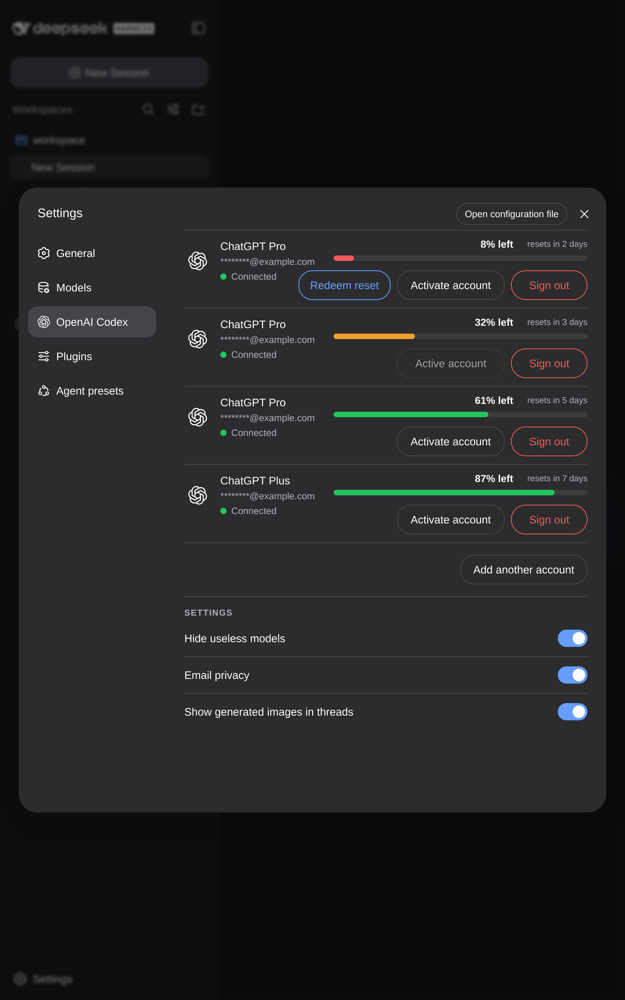

<p align="center">
  
</p>

# OpenAI Codex Plugin for the DeepSeek Harness

Keep several ChatGPT OAuth accounts signed in and choose the active account from DSH Settings. When one account reaches its limit, select another saved account without signing out. Account selection is global, not per conversation; requests already in flight keep their original account.

## Features

- Multi-account OpenAI Codex OAuth and usage controls
- Web search and image generation
- Chinese UI follows the language selected in DSH
- Model identity and routing guidance for agents
- The official OpenAI Docs skill, vendored from
  [openai/skills](https://github.com/openai/skills/tree/main/skills/.curated/openai-docs)

The plugin adds a durable runtime-context snapshot that tells an agent its
active provider/model, the models advertised by the `openai-codex` adapter,
what Sol, Terra, and Luna are for, and which orchestration tools accept an
explicit model. DSH writes this snapshot at session start and replaces it only
when the active model or advertised catalogue changes; it is not repeated on
every request.

## Compatibility

This compatibility update targets **DSH 0.2.2-rc.3**, Node.js **24.9.0 or newer**, and the shipped `llm-pi-ai` adapter. The package declares that exact DSH requirement; older DSH versions are not supported by this update.

The account card uses DSH's authenticated Remote transport. Only the host owner can inspect or modify the saved account pool. The separate account-control server on port 1456 is not used. Browser OAuth still uses its loopback callback on port 1455; device-code sign-in does not need that callback.

Keyless tests cover mocked model routing, account selection, refresh failures, restart persistence, gateway dispatch, and the React account card. Profile installation and real OAuth/model acceptance must also be verified by the operator before replacing a working installation; mocked tests do not prove account eligibility or available quota.

## Install the DeepSeek Harness Codex plugin

Add it to your DSH Web profile:

```sh
dsh plugin --profile web add github:Eve-146T/DSH-CODEX-SUBSCRIPTION-POOL
```

## Tutorial

```sh
# install the plugin
dsh plugin --profile web add github:Eve-146T/DSH-CODEX-SUBSCRIPTION-POOL
# restart dsh
dsh --profile web
```

Then:

1. Open Settings
2. Click OpenAI Codex in the sidebar and login
3. Choose OpenAI Codex as the provider in the Models tab

To add another account, choose **Add another account** and complete OAuth with that account. Choose **Activate account** on its card to switch future model, compaction, search, and image requests. Both saved accounts and the active selection survive restart. Selection does not automatically move to another account after a quota error.

If the target account cannot refresh, selection fails and the previous account remains active. If the host cannot confirm account state after a storage failure, requests stop and the card asks you to select an account again. **Sign out** removes a saved login; it is not required for switching.

The optional model filter recognizes GPT-6 and Astra rollout entries while keeping the current model selection unchanged. Models and quotas remain controlled by OpenAI; a listed model does not guarantee access.

## Images

The `image_gen` tool creates an image and returns it as a durable conversation attachment. It preserves the generated image bytes and displays a preview in the conversation. It does **not** save a copy into the workspace.

**Breaking change:** `output_path` and the `savedPath` result are no longer supported. A caller supplying `output_path` gets an attachment-only error before any provider request. DSH 0.2.2-rc.3 does not expose a public policy-enforced binary writer, so the plugin does not substitute a raw filesystem write or a base64 text file.

## Replacing another Codex plugin

Do not run two adapters that both own `openai-codex`. Prepare and test the new package before removing the working adapter. Retain its exact package and profile configuration for rollback, and preserve its credential store without signing out or revoking the old login. Stop related work before the final replacement and verify the existing GUI after restart.

Use a fresh OAuth authorization for this pool. Do not copy a live rotating refresh token from another plugin or the Codex CLI into a concurrently running process. Test installations need a separate DSH home and separate logins. The pool stores credentials at `$DSH_HOME/openai-codex-auth.json`; the single-account `dsh-codex` store with a leading dot is separate and is not imported or modified.

Check the differences before switching:

| Capability | This bundle |
| --- | --- |
| Chat, tools, compaction, input images | Uses the current DSH `llm-pi-ai` Codex route; verify the models available to your account |
| Saved accounts | Manual global switching; no automatic rotation |
| Search | Existing Codex Responses search provider |
| Image generation | `image_gen`, attachment-only output |
| Image editing and reference images | Not supplied by this image tool |
| `read_image` HTTP URL extension | Not supplied; DSH's own image tools remain available |
| Other plugins' Fast Mode, fallback, proxy, and TUI controls | Not migrated by this bundle |

Acceptance includes A → B → A without another login, persistence after restart, and a representative existing conversation. A fake second account is sufficient for regression tests but not for two-real-account acceptance. If replacement fails, stop the new plugin and restore the old package and configuration without deleting either credential store.

## Development

```sh
pnpm install --ignore-scripts
pnpm run typecheck
pnpm test
pnpm pack
```

`pnpm test` builds the published host entrypoints, typechecks the test fixtures, then runs the keyless tests. The account-routing fixtures use synthetic credentials and mocked SSE responses. They do not require or read real OAuth files. Do not put credentials, private profile backups, or account-status exports into the repository or package.

## License

This project is distributed under [GPL-3.0-only](./LICENSE).
The vendored OpenAI Docs skill retains its upstream
[license](./skills/openai-docs/LICENSE.txt).
